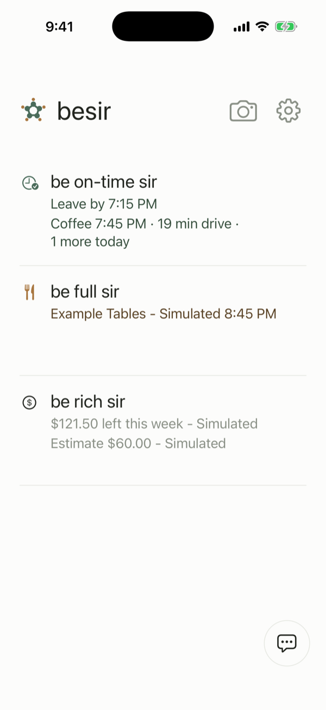
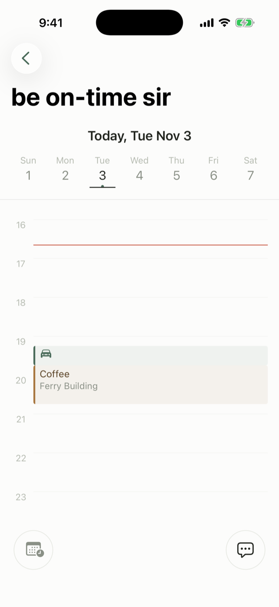
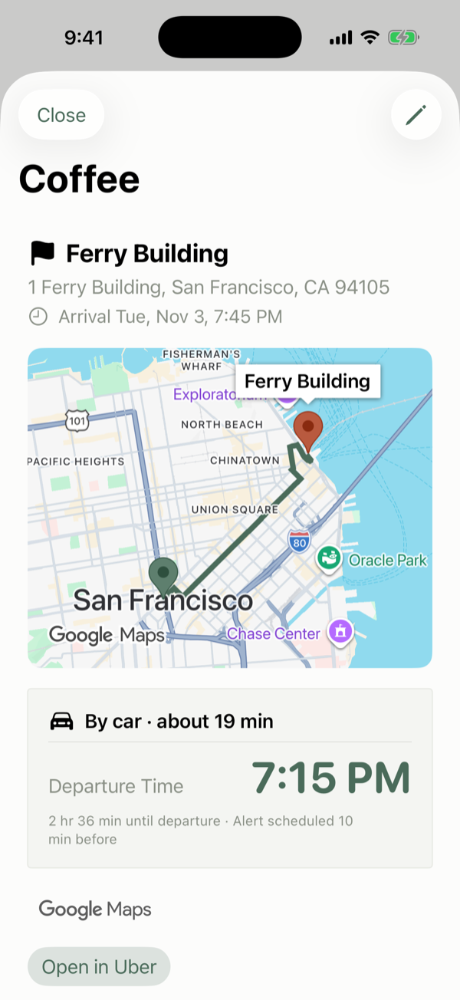
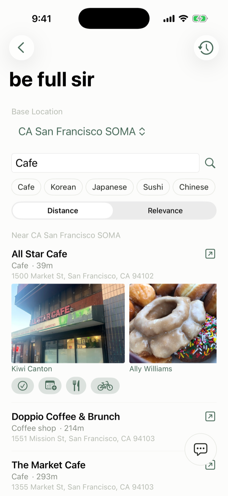
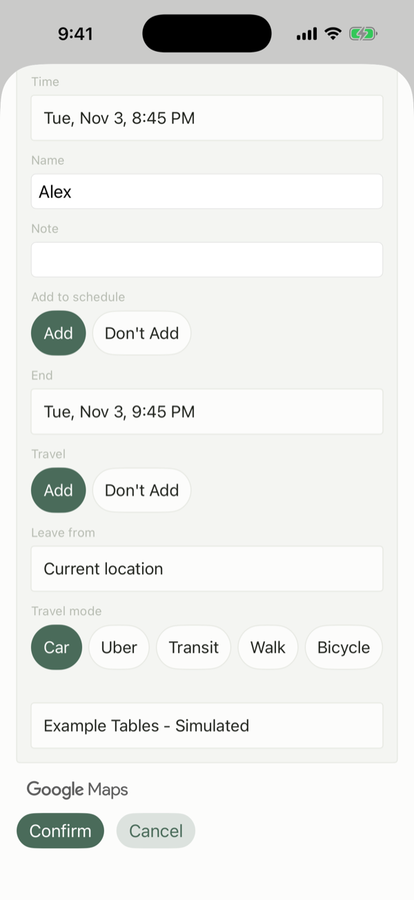
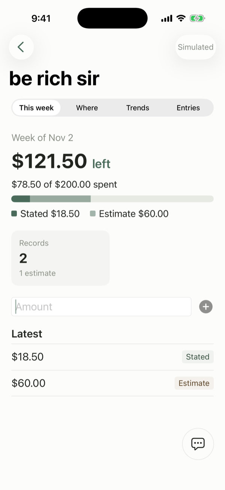
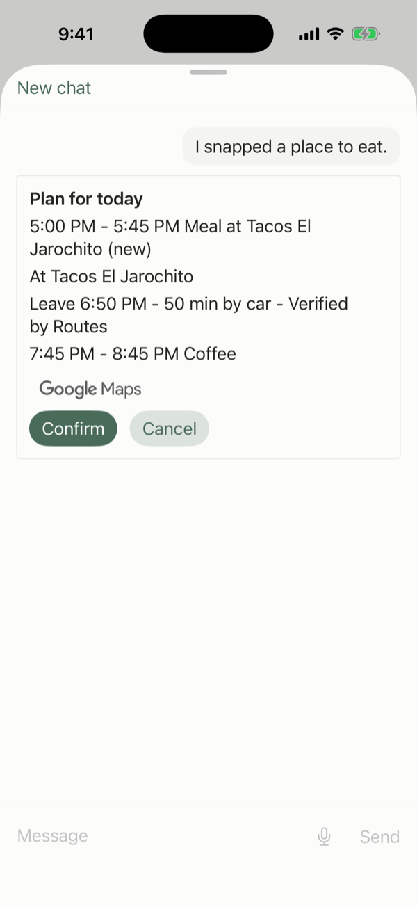
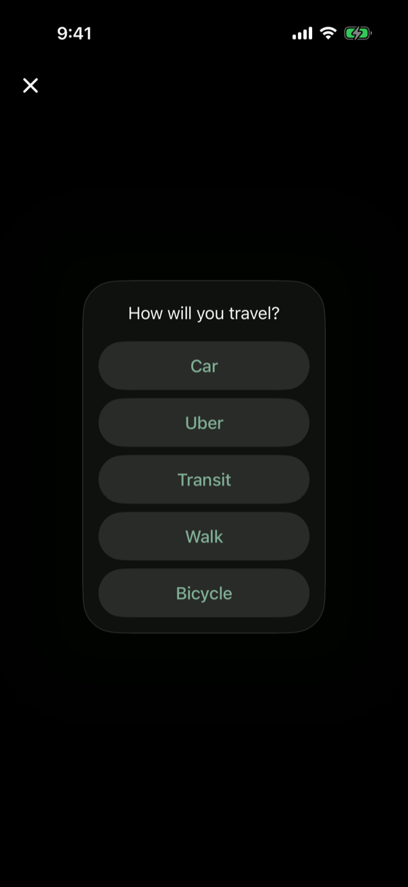
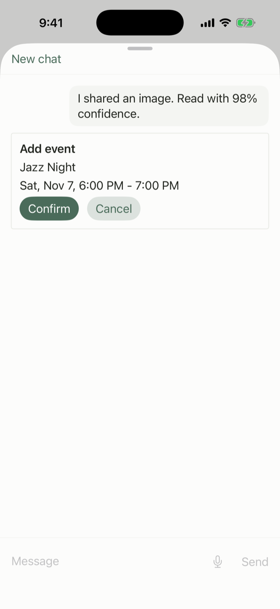
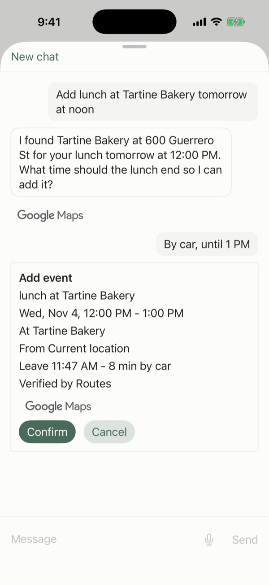

# besir — the app that connects your apps

An iOS planning agent, powered by Meta Muse Spark, with Muse Spark Open reading images and Muse Voice Transcribe turning speech into text, that sits between the apps on your phone. What you find in one app becomes a plan, and the plan is carried to the next app for you.

## Why besir: connecting apps

Google connected websites. Facebook and Instagram connected people. **besir connects the apps on your phone.**

Today a plan is spread across apps: a festival you saw on Instagram, a restaurant you found on a map, a booking in a reservation app, the time in your calendar. You copy and paste between them yourself. besir is the layer in the middle: it reads what you share, turns it into a plan with Muse Spark, and hands each piece to the app that needs it, filled in so that you only check it and confirm.

Three principles guide every connection:

- **Convenience** — besir fills in the details (time, place, travel time, party size); the user's only job is to confirm.
- **Your apps stay your apps** — besir does not replace the apps you already use, so there is no new service to sign up for and no habit to give up. Instead it connects them, even apps from fields that seem to have nothing in common, so that the whole plan can be managed from one place.
- **The user stays in control** — a plan, a booking or an order is saved or sent to another app only after the user taps Confirm on its card (or Add on a form they filled in); a few actions run at once: `Open in Uber`, `I ate here` and a cancel from History when tapped, a spend recorded by hand when `Record spend` is tapped, and a spend the user states in the chat when the assistant records it; and besir only receives what the user chooses to share (no scraping).

Not every app offers an API or MCP server for this, so besir carries data in one common shape — which app it came from, which app it goes to, what it is and its status — whatever the app on the other side supports.

As an MVP, besir starts with one everyday scenario — an event you came across, a place to eat nearby, a booking and the time in your calendar — and connects the few apps that scenario needs. Each app connected later adds to what the others can do, so the value of besir grows with every new connection. The table below shows where each connection stands today.

| Connection | Direction | Status |
|---|---|---|
| Instagram post or screenshot → besir, through the iOS share sheet | in | built for screenshots and photos; an Instagram post shares only its link, which besir does not open |
| Shared image → Muse Spark Open, read into a title, time and place | in | built |
| Camera photo → Muse Spark Open, read into what it shows (a poster, a place to eat or another place); for a place, the place is then found with Google Places | in | built |
| Voice clip → Muse Voice Transcribe, turned into a chat message | in | built |
| besir ↔ Google Places, Routes and Maps (places and their photos, travel times, the route map) | both ways | built |
| Muse Spark agent → besir schedule, through tool calls the user confirms | in | built |
| besir ↔ Apple Calendar | both ways | built: the events you confirm are written to the default calendar, and Plan my day and the camera snap's meal plan read today's events |
| besir → a reservation app, filled in from the plan, and the booking back into besir | round trip | built with a simulated partner app, Example Tables, clearly labeled *Simulated*; no real reservation app yet |
| besir → a delivery app, filled in from the plan, the order back into besir and its estimated total sent to the budget app | round trip | built with a simulated partner app, Example Delivery, clearly labeled *Simulated*; no real delivery app yet |
| besir ↔ a budget app (this week's dining budget left, a spend, the estimated spend of a booking or an order) | round trip | built with a simulated partner app, Example Budget, clearly labeled *Simulated*, and shown on the be rich sir screen; no real budget app yet |
| besir → Uber, the trip's destination as the drop-off | out | built as a link that opens Uber; besir makes no Uber request and gets nothing back |
| besir → health apps | out | roadmap |

## Using besir

Each feature below has a screenshot from the iOS simulator, in English with the location set to San Francisco (the camera snap shots use the photo's own street in Menlo Park), and a few steps. The partner apps are simulated; in these shots, partner data appears with the word `Simulated`.

### 1. The lobby

1. Open besir. Each row shows today's key lines, such as `Leave by` with a time, a partner booking marked `Simulated`, or what is left of this week's budget.
2. Tap a row to open it. The header holds the `Camera` icon and the `Settings` gear, and the round `besir AI` button sits at the bottom right; the icon and the button show only when besir has its Worker address and app token.

### 2. be on-time sir: schedule and leave-by alarm

 

1. Tap `be on-time sir`. It opens on the month; tap a day to see its timetable.
2. Long-press an empty time in the timetable to open `New Activity`. Fill in `Activity Title`, pick a `Place` and set the time; then set `Outbound Travel` to `Create`, choose the `Origin` and the `Outbound Travel Mode`, and tap `Add`.
3. Tap the travel block to see the `Departure Time` and when the alert is scheduled. `Open in Uber` opens Uber with the destination as the drop-off.

### 3. be full sir: places to eat and partner orders

 

1. Tap `be full sir`, type in `Menu or type of place` (or tap a chip such as `Cafe`) and tap `Search`.
2. Tap a result to open it. Its icon buttons are `I ate here`, `Add meal event`, and one per partner: `Reserve a table` (Example Tables) and `Order delivery` (Example Delivery).
3. Fill in the partner card and tap `Confirm`. Its last line ends in `Simulated`, and `History` in the toolbar lists the bookings, each with a `Cancel` button.

### 4. be rich sir: budget and stats

1. Tap `be rich sir`. The `This week` tab shows what is left (or over) of the week's dining budget and how much of $200.00 is spent; the toolbar says `Simulated`, because the budget app, Example Budget, is simulated.
2. Type an amount in `Amount` and tap `Record spend` (the plus).
3. `Where`, `Trends` and `Entries` are drawn from the same ledger on the phone.

### 5. Camera snap

 

1. Tap the `Camera` icon in the lobby. A phone opens the camera; with no camera, as in the simulator, the photo library opens.
2. Take or pick a photo of a poster, a place to eat or another place. For a place, besir looks for it nearby when your location is on; if several match, tap one.
3. For a place to eat, answer `How will you travel?`, and besir proposes a meal for today on a `Plan for today` card. Tap `Confirm` to add it.

Muse Spark Open reads the photo, and Muse Spark makes the plan. Photo used for these shots: "Taqueria El Jarochito in Menlo Park, California (front door)" by Suiren2022, [CC BY-SA 4.0](https://creativecommons.org/licenses/by-sa/4.0), via [Wikimedia Commons](https://commons.wikimedia.org/wiki/File:Taqueria_El_Jarochito_in_Menlo_Park,_California_%28front_door%29.jpg).

### 6. Share sheet: screenshot to event

1. In Photos or another app, share a screenshot or photo and choose besir.
2. Tap the notification from besir.
3. besir reads the image and opens the chat. If it asks how you will travel, answer; then check the values on the `Add event` card and tap `Confirm`. With two or more shares waiting, the `Plan my day` button plans them together.

Muse Spark Open reads the image, and Muse Spark makes the card.

### 7. besir AI chat with voice

1. Tap the round `besir AI` button. Type in `Message` and tap `Send`, or tap the microphone, speak (up to 28 seconds) and tap it again.
2. The recording is turned into text and sent like a typed message.
3. besir answers, and each change to the schedule comes as a card; nothing is added to the schedule until you tap `Confirm`.

Muse Spark answers, and Muse Voice Transcribe turns the recording into text.

### Models

- **Muse Spark** (`muse-spark-1.3`, Worker `/ai`): the planner behind the chat and its cards.
- **Muse Spark Open** (`meta-models/muse-spark-open-1026`, served on Baseten, Worker `/vision` and `/snap`): reads a shared image or a camera snap photo into fixed fields, as the Open weight section below explains.
- **Muse Voice Transcribe** (`muse-voice-transcribe-1.0`, hosted by Meta, Worker `/voice`): turns a recorded clip into text; the clip goes to Meta's own API, not to Baseten.
- **Google Places and Routes** (Worker `/places`, `/routes` and `/place-photo`): place search, place photos and travel times; the route map is drawn with the Google Maps SDK.

Credits: Google results in the app carry the Google Maps mark, and the camera snap photo is credited in entry 5.

## Open weight: Muse Spark Open on Baseten

For images, the work is split between two models. Muse Spark Open (`meta-models/muse-spark-open-1026`, served on Baseten) reads one image per request into fixed fields. Muse Spark, the planner, never receives the image.

- **Shared screenshots and photos** go to the Worker's `/vision` route, which returns `title`, `time`, `place` and `confidence` (0 to 1). The prompt asks for null when a field is not visible, and for `time` as written, not converted. Plan my day reads its shared images through the same route, up to five per tap and three at a time. The planner gets these fields.
- **Camera snap photos**, taken with the camera or picked from the library on the camera screen, go to the Worker's `/snap` route, which returns `kind`, `name`, `place_type`, `text`, `title`, `time` and `confidence`; `kind` is one of `event_poster`, `food_place`, `other_place` or `unknown`. Only a poster hands its fields to the planner (title, time and venue name). For a food place or other place, the app makes one Google Places search within 500 m, nearest first, when the phone has a location fix, with the sign name, or else the place type plus any short sign text; with neither, or with a search text shorter than two characters, there is no search. No result ends with a fixed line; with several, the user picks one of up to three. The planner gets that place (name, address and `place_id`), not the sign text.

Why fields and not the image:

- **They feed the confirm card.** The planner turns what it gets, the fields or the found place, into a card, and nothing is added to the schedule until the user taps Confirm.
- **The fields can be checked.** An image share read outside Plan my day, with or without a caption, with confidence under 0.5 or no time, or a poster with no time (at 0.5 or more), adds a line telling the planner to ask the user to confirm the values first. A camera reading of kind `unknown` or under 0.5, a poster included, ends with a fixed line and no planner call. The Worker and the app both refuse a reading of the wrong shape, and the Worker cuts each text to 200 code points.
- **Text in a picture is passed on as data.** The Worker prompt tells the model to ignore any instruction inside the image, and the app hands the values to the planner as JSON values after a sentence that calls them data, not instructions.
- **The prompt and the field list are fixed in the Worker.** The app's request body carries only the image and its type.
- **The Baseten key is a Worker secret.** It is not in the app.

Both Worker prompts tell the model never to identify, describe or infer anything about people or faces.

## Pre-existing code (before the hackathon kickoff — Oct 26, 2026, 12:00 PM ET)

Everything in the baseline commit was written before the hackathon. It is tagged
[`pre-hackathon-baseline`](https://github.com/paul8004-lee/besir_global/tree/pre-hackathon-baseline).

What the baseline already does:

- **Calendar** — month grid, week strip and day timetable; long-press a block in the timetable to drag it to a new time
- **Manual entry** — add and edit trips and activities by hand, through one shared edit card that shows every value before saving
- **Recurrence rules** — weekly, every N weeks, daily, monthly (nth weekday), yearly, lunar and date-list repeats, with optional skipping of Korean public holidays
- **Favorites** — saved places such as home and work
- **Place search, travel time and route map** — place search and per-mode travel time (car, transit, walk, bicycle) through Kakao, with a MapKit search fallback and a native route map; during the hackathon these were replaced by Google Places, Google Routes and a Google map
- **be full sir** — find a place to eat near a chosen location, log what was eaten, and turn a pick into a meal block with round-trip travel
- **Service home** — the start screen that switches between be on-time sir and be full sir (now the lobby with three rows, built during the hackathon)
- **Settings** (the Rules and Memory tabs were added during the hackathon)
- **Schedule model and `Store`** — events, activities and favorites held in a single store with on-device persistence
- **Departure-time calculation** — departure = arrival − travel time − buffer
- **Local notifications** — departure alarms scheduled from that calculation
- **Share extension skeleton** — receives shared text and images and hands them to the app through a shared inbox
- **Theme** — color tokens and the app mark, with light and dark mode following the device setting

The AI layer, calendar sync and map view of the earlier app were removed from the baseline; their replacements were built during the hackathon: the Muse Spark agent, Apple Calendar through EventKit and a Google map.

One commit sits between the baseline tag and the first hackathon work: [`89c8ab3`](https://github.com/paul8004-lee/besir_global/commit/89c8ab3d7e495ebb5f6e24724ffea86857bd2378), a one-line `.gitignore` tidy-up made before the kickoff (Oct 26, 2026, 07:40 AM ET).

## Built during the hackathon (Oct 26 – Nov 4, 2026)

Everything that differs from the baseline: [`pre-hackathon-baseline...main`](https://github.com/paul8004-lee/besir_global/compare/pre-hackathon-baseline...main).

Each merged unit of work gets one short line below: what was newly built and a link to its commit. From card t62 on, the details of each card (scope, tests, walk results) are in its issue and pull request.

- **Muse Spark proxy** — a Cloudflare Worker that forwards `/ai` to Meta Muse Spark and relays `/places` and `/routes` to Google; keys live only in Worker secrets — [`fa5a918`](https://github.com/paul8004-lee/besir_global/commit/fa5a918b826e07db8ee1fe64c38257c7a9244afe)
- **Own app identity and a working build** — new bundle IDs and App Group, and the iOS build restored after the baseline trim — [`4b84722`](https://github.com/paul8004-lee/besir_global/commit/4b84722405c861823865bf762500ef6a9aa24f4a)
- **English app screens and dates** — screen text and date formats in `en_US` (375 strings) — [`9567b8c`](https://github.com/paul8004-lee/besir_global/commit/9567b8c3b50ed2022903e3c4e149a81f8efe8c40)
- **English location permission text** — the iOS location prompt in English — [`b252ec1`](https://github.com/paul8004-lee/besir_global/commit/b252ec15aa033ef5b1f2638711b2d3c7f32108ec)
- **Worker deployment** — the proxy Worker live on Cloudflare with its secrets; the first Muse Spark call succeeded — [`fa5a918`](https://github.com/paul8004-lee/besir_global/commit/fa5a918b826e07db8ee1fe64c38257c7a9244afe)
- **Approximate place name fix** — a region and city with the same name (`Seoul Seoul`) show once — [`8cce40d`](https://github.com/paul8004-lee/besir_global/commit/8cce40d93d59040a6757566bfb6098d4bd3e1806)
- **Google key on the Worker** — the Google key held as a Worker secret; Places and Routes called live once — [`fa5a918`](https://github.com/paul8004-lee/besir_global/commit/fa5a918b826e07db8ee1fe64c38257c7a9244afe)
- **Worker placement near US East** — the Worker runs next to `aws:us-east-1`, which ended the `model_not_found` answers — [`702c90b`](https://github.com/paul8004-lee/besir_global/commit/702c90ba7c176926cb908482d64946f8e30596bc)
- **Muse Spark schedule agent** — a chat sheet where Muse Spark looks up, creates, changes and deletes events through app tools, each change confirmed on a card; the first unit test target — [`9853f8c`](https://github.com/paul8004-lee/besir_global/commit/9853f8c40b8a549f1dba92a94f57159fda7ed956)
- **Agent audit repairs** — cleaned titles and place names for the agent, the current time zone on every use, the start time re-checked at Confirm — [`e48a473`](https://github.com/paul8004-lee/besir_global/commit/e48a4737ea2d3187f775de8f2722645cf50a3672)
- **Image reading route** — a Worker `/vision` route that reads one image into a title, a time and a place — [`78642ec`](https://github.com/paul8004-lee/besir_global/commit/78642ec814e9952a27b5832a04616d18a8ebc666)
- **Google place search** — every place search goes to Google Places through the Worker, with the Google Maps mark — [`5ed7598`](https://github.com/paul8004-lee/besir_global/commit/5ed7598699c8ef8460eb1115604b4370154f1f47)
- **Agent reply polish** — no preface bubbles, plain 12-hour replies, and a message field that grows to five lines — [`bfacd61`](https://github.com/paul8004-lee/besir_global/commit/bfacd6153c8dbfe4a00d47842ef54f2d121d6a2f)
- **Google travel times** — car, transit, walk and bicycle times from Google Routes, with English transit steps — [`2619c40`](https://github.com/paul8004-lee/besir_global/commit/2619c409cd3e165dca8d211a8aac984b534fd7e1)
- **Share to event** — a screenshot or photo shared to besir is read by Muse Spark and becomes an Add event card — [`46cf9d8`](https://github.com/paul8004-lee/besir_global/commit/46cf9d89b825337ae564a45d81a39b27e004f6e5)
- **Chat freeze fix** — a long message in a full chat no longer freezes the app — [`b4d52d5`](https://github.com/paul8004-lee/besir_global/commit/b4d52d5f978f2697cde60d2dc69ad31f6c7bab87)
- **Apple Calendar** — confirmed events are written to the default calendar through EventKit; besir edits and deletes only the events it wrote — [`40c9c00`](https://github.com/paul8004-lee/besir_global/commit/40c9c000ceef1a7c3fb854a62c7bf15ea293db91)
- **Connections log** — every connection (Google, image reading, the chat agent) is logged on the phone as one common packet, with no personal content — [`a92d77d`](https://github.com/paul8004-lee/besir_global/commit/a92d77d6bbfd90a64150535c079c14d4944ab358)
- **Starting point fix** — a real location fix replaces the IP-based guess as the trip origin — [`4a3b0e8`](https://github.com/paul8004-lee/besir_global/commit/4a3b0e82ae61ac60c27f1cf6df532ca541e4e973)
- **Places and travel times in the chat agent** — the agent searches places and looks up travel times, and an Add event card carries a leg verified by Routes — [`8a6468a`](https://github.com/paul8004-lee/besir_global/commit/8a6468a1bde375800caf52a93905ffac01d5e192)
- **Google map on the travel-leg screen** — the origin and the destination drawn on a Google map from the Maps SDK — [`2257058`](https://github.com/paul8004-lee/besir_global/commit/225705898f65c30ebf37b3c0332bdb24f02347e2)
- **Simulated table-booking round trip** — a `request_booking` tool and a `/booking` Worker route answered by a fictional partner, Example Tables — [`2c5133b`](https://github.com/paul8004-lee/besir_global/commit/2c5133bb10a803179c9ec1bdc44cb94ee9ea5670)
- **Short line for a shared item in the chat** — the chat shows a short line for a share instead of the data the model receives — [`c7328cc`](https://github.com/paul8004-lee/besir_global/commit/c7328cc37cc3353f53ad172fb9abda9e5c40fa48)
- **Connections log follow-up** — tool names only from besir's own tools, a `No route` status, and one-line rows — [`04c75e3`](https://github.com/paul8004-lee/besir_global/commit/04c75e3bf258d94e8f6fce4a48ec5023eba7abd8)
- **Live replan** — car trips re-checked with live traffic on app open and alert tap, with an earlier, later or late note and a drafted delay message — [`6b80655`](https://github.com/paul8004-lee/besir_global/commit/6b8065562e30cece5635c68028705b107fdc1dd2)
- **Location permission fix** — Current Location works on any grant, and an IP-based guess is never saved as an origin — [`5ffb931`](https://github.com/paul8004-lee/besir_global/commit/5ffb931c8f85816b7bdf609c450115be83157a02)
- **Share card without diagnostic lines** — the Debug share card shows diagnostic lines only when a share fails — [`6188ec3`](https://github.com/paul8004-lee/besir_global/commit/6188ec3fa645b77aac7985dc3e4a107e852d151e)
- **Connections tab removed** — Settings is back to General and Favorites; the connection log itself is unchanged — [`ca07b26`](https://github.com/paul8004-lee/besir_global/commit/ca07b26c111d66ec2a4de4f4f91b3b662d714ea3)
- **Live replan after the alert** — a later departure found after the alert shows `Leave by …` instead of the red warning — [`7712802`](https://github.com/paul8004-lee/besir_global/commit/771280258ece346619b9ea634b0250250d40e391)
- **Chat lookups in one connection flow** — Places and Routes records carry the flow id of the chat message that caused them — [`7087126`](https://github.com/paul8004-lee/besir_global/commit/708712673cefff938b68a6b4ac67ec392d5b8169)
- **Failed place search told apart from an empty one** — the agent says places are unavailable instead of "nothing found" — [`047239a`](https://github.com/paul8004-lee/besir_global/commit/047239a7f3b4241e93624910e8cbc3e032c8cca4)
- **be full sir and nearby-suggestion fixes** — no caption under the Home button, a nearby search when the base changes, suggestion titles by type, and the chosen place's own name in the Place field — [`0412e99`](https://github.com/paul8004-lee/besir_global/commit/0412e995152b4789552180543619dfa9d9be63c5)
- **Plan my day** — one tap sends the shared items and today's calendar to the agent, which proposes the stops on one card; the app checks overlaps and travel times with Google Routes — [`b474859`](https://github.com/paul8004-lee/besir_global/commit/b4748590292728fe4ad8befdbf063096eb6bdf28)
- **Repeat text read by rules** — common English repeat phrases such as `every Monday until Nov 30` become a repeat rule inside the app, with no AI call — [`7cf990d`](https://github.com/paul8004-lee/besir_global/commit/7cf990d5690776d851949353ee1f4da10459e376)
- **Brief README lines** — each line here is now a short index entry; card details move to issues and pull requests — [#5](https://github.com/paul8004-lee/besir_global/pull/5)
- **Issue and pull request templates** — one card template for issues and one for pull requests, so every card reads the same — [#8](https://github.com/paul8004-lee/besir_global/pull/8)
- **Calendar not read, said so** — when Plan my day cannot read the calendar, the agent is told so and says its plan was not compared with the calendar, instead of calling the day clear — [#10](https://github.com/paul8004-lee/besir_global/pull/10)
- **Route line on the Google map** — a travel leg's map now draws the real route from Google Routes between the two pins, for car, walk, bicycle and transit, in light and dark — [#27](https://github.com/paul8004-lee/besir_global/pull/27)
- **Camera snap** — one photo and the phone's location find the exact place; a food place becomes a meal in the free time, a poster or any other place becomes a plan, and the photo is not kept; the same photo-to-place flow can later take its photo from Meta AI glasses (roadmap, not built) — [#30](https://github.com/paul8004-lee/besir_global/pull/30)
- **Absurdly long legs are not late arrivals** — in Plan my day, a leg over six hours counts as unchecked instead of showing a huge late-arrival time — [#31](https://github.com/paul8004-lee/besir_global/pull/31)
- **Example Budget (Simulated)** — a simulated budget app: ask what is left this week, say what you spent, and a booking sends its estimated spend; facts only, no advice — [#36](https://github.com/paul8004-lee/besir_global/pull/36)
- **Share, then one tap** — after a share, one fixed notification brings besir to the front with a tap, and the banner is cleared when besir opens — [#37](https://github.com/paul8004-lee/besir_global/pull/37)
- **Repeat saved as its rule** — a repeating activity is stored as one rule and its days are worked out when shown, so `every Monday` needs no end date and has no 182-day cap — [#38](https://github.com/paul8004-lee/besir_global/pull/38)
- **Example Delivery (Simulated)** — a simulated delivery app: ask for food to arrive at a set time, confirm one card, and the order, an optional meal entry and the estimated total sent to Example Budget follow; facts only, no advice — [#45](https://github.com/paul8004-lee/besir_global/pull/45)
- **Camera guard and 500 m place radius** — the camera snap refuses a photo until the capture session runs, and a sign photographed up to 500 m from its place now finds it (was 250 m) — [#49](https://github.com/paul8004-lee/besir_global/pull/49)
- **Time wheel commits what it shows** — opening an unset Start or End time on a new activity makes the time its wheel shows the value at once, so Add is live without turning the wheel — [#50](https://github.com/paul8004-lee/besir_global/pull/50)
- **Repeat legs follow their occurrence** — deleting a whole series keeps the travel legs of an occurrence already saved on its own, and after a time zone change the legs of repeat occurrences move onto the occurrence so the departure alarm fires at the right time — [#57](https://github.com/paul8004-lee/besir_global/pull/57)
- **Tap away closes the time wheel** — with a time wheel open on New Activity, an activity or New Event, a tap on the empty area outside the edit card closes it, the same as a tap on the card's own empty space — [#58](https://github.com/paul8004-lee/besir_global/pull/58)
- **Repeat legs get a missing travel time later** — a repeating activity's travel leg that a failed lookup left without a time gets one on a later fill, so its departure alarm is set; new legs copy the most common time of the series, not the first match — [#59](https://github.com/paul8004-lee/besir_global/pull/59)
- **Delete This Event Only comes first** — in both delete popovers of a repeating event (Edit Activity and the event detail screen), the one-occurrence choice now sits above Delete Entire Series, which cannot be undone — [#60](https://github.com/paul8004-lee/besir_global/pull/60)
- **Current Location on the return Destination** — the Destination of a return trip on New Activity and Edit Activity now offers Current Location like the Origin does, so getting back to where you stand needs no place search; with location permission off the existing note shows and the saved place stays — [#62](https://github.com/paul8004-lee/besir_global/pull/62)
- **A repeating activity block does not cross a day by drag** — dragging one occurrence of a repeating activity so that its start would land on another day now cancels the drag and the block springs back, instead of offering a series move that clamps to 23:59; a drag inside the same day opens the same choice as before, and one-time activities still move across days — [#63](https://github.com/paul8004-lee/besir_global/pull/63)
- **One action card from the partner's field list** — the simulated delivery partner names the fields of an order and of its result, and besir draws one fill-and-approve card from that list instead of a hand-written delivery card; the arrival time and the money in the result are acted on by kind, and the suggested delivery place also sees repeating activities — [#65](https://github.com/paul8004-lee/besir_global/pull/65)
- **A repeating activity's travel leg does not cross a day by drag** — dragging the outbound leg of one occurrence of a repeating activity so that the activity's start would land on another day now cancels the drag and the leg and activity spring back, the same rule as for the activity block; a drag inside the same day opens the same choice as before, and the return leg and one-time activities still move across days — [#66](https://github.com/paul8004-lee/besir_global/pull/66)
- **A cancelled day plan is said to be cancelled** — after Cancel on the Plan my day card, the agent is told the plan was cancelled and nothing was added, so its closing line should say so — [#69](https://github.com/paul8004-lee/besir_global/pull/69)
- **Tests for a one-time activity's leg drag across midnight** — regression tests that dragging a travel leg of a one-time activity across midnight changes only the dragged edge of the activity (the start for an outbound leg, the end for a return leg), and that dragging the activity block itself moves the whole activity; the reported whole-activity move did not reproduce on a leg drag, so no app code changed — [#71](https://github.com/paul8004-lee/besir_global/pull/71)
- **Chat keyboard stays down after a reply** — the chat message field gives up its focus and the system keyboard each time a reply re-enables the field; in the simulator walk the keyboard stayed down after a Confirm, a Cancel, a typed message and a plain reply, and one tap on the field raises it again; the chat sheet also shows its grab handle — [#73](https://github.com/paul8004-lee/besir_global/pull/73)
- **Replan follow-ups** — a tap on an old alert banner moves the pending alert, no tap looks up traffic again within five minutes, the late message is fixed text with no AI request, late minutes follow the clock, and opening the app reschedules alerts before the after-alert lookups — [#74](https://github.com/paul8004-lee/besir_global/pull/74)
- **Any simulated partner through one code path** — the app learns the simulated partners from a directory, the agent asks one with two tools, and besir draws one fill-and-approve card from the fields that partner names; a `time` result can be added to the schedule with a length the user sets, a `money` result is recorded as an estimated spend, and the table booking is the first partner on this path, with no app code of its own — [#72](https://github.com/paul8004-lee/besir_global/pull/72)
- **Unused calendar-sync code removed** — an unreachable calendar-sync row on New Event, an unused per-leg sync flag and a stale consent comment are gone; nothing the user sees changes — [#79](https://github.com/paul8004-lee/besir_global/pull/79)
- **A partner lists its own places for a field** — on a partner card, the typed place is looked up at the partner, which answers its own candidates (the table partner through Google Places on the Worker); the user taps one, even for an exact name, and the booked entry keeps its address and coordinates for a travel leg — [#80](https://github.com/paul8004-lee/besir_global/pull/80)
- **Large repeats no longer freeze the screen** — with Apple Calendar on, the calendar mirror lets other work run after each saved event, so adding, moving or deleting a repeat of 60 days or more no longer blocks the main thread for 260 ms to 4.7 s; measured first on the real calendar — [#81](https://github.com/paul8004-lee/besir_global/pull/81)
- **Running late: switch the booked dinner to delivery** — when the leg to a table booked through the simulated partner is late, its departure card offers one button that cancels the booking, orders delivery for the new arrival, moves the entry and sends the estimated spend to Example Budget, with what is left (or over) shown first; a booking card can now add its travel leg — [#83](https://github.com/paul8004-lee/besir_global/pull/83)
- **Camera circle beside the besir AI circle** — the camera circle now sits left of the besir AI circle on one row instead of above it, so it no longer covers the dates in the lower right of the month view — [#84](https://github.com/paul8004-lee/besir_global/pull/84)
- **Smoother swipe-close of the chat sheet** — closing the besir AI chat by swiping it down over be on-time sir hitched at the finger lift because the month grid under it redrew its text; month cells no longer carry a hidden height template each and the share-import pass no longer announces unchanged values, which cut the release gap from about 220 ms to about 120 ms on the simulator (not yet checked on a phone) — [#87](https://github.com/paul8004-lee/besir_global/pull/87)
- **Repeatable row groups for partner cards** — a partner can list a group of rows: a `+` chip adds a row, a right-to-left swipe deletes one, Confirm sends the rows to the partner, the model fills row members from the user's own words (a quote-checked pick), and a `pick_one` can have any number of options; no partner uses a group yet — [#88](https://github.com/paul8004-lee/besir_global/pull/88)
- **Say what failed when the step limit ends a message** — when a failed place search or route lookup is the last lookup before the step limit, the chat now shows one fixed line saying what failed (for example, no route was found) before the unchanged step-limit line; the line is app text, with no AI call and no change to the limit — [#89](https://github.com/paul8004-lee/besir_global/pull/89)
- **Delivery on the common partner card** — the late-to-delivery button is removed and the simulated delivery partner is now drawn on the same partner card as the others, with its delivery-only app code deleted — [#94](https://github.com/paul8004-lee/besir_global/pull/94)
- **Route map refits for a new label width** — on a travel leg's map, when the destination keeps its coordinates but its name becomes longer or shorter, the camera now fits the pins again so the name label is not clipped at the edge; covered by unit tests, and the simulator walk found no same-coordinates pair to try it on — [#95](https://github.com/paul8004-lee/besir_global/pull/95)
- **Share hand-off covered by tests** — the hand-off that passes a shared text or image to the chat is now one named function that four new tests call, so a swap of what the model gets and what the chat shows, or a wrong order of opening the chat and reading the session, fails a test; nothing the user sees changes — [#96](https://github.com/paul8004-lee/besir_global/pull/96)
- **Plan-turn id refused by update and delete, covered by a test** — a test that a plan-turn id such as `e1` or `e9` given to `update_activity` or `delete_activity` is refused with the find-the-event line and writes nothing, while a stored activity's own id still gets its card; no app code changed — [#97](https://github.com/paul8004-lee/besir_global/pull/97)
- **Be full sir by hand: photos, partner buttons, History and one-tap cancel** — a result row now expands to up to three Google place photos with the author line, the meal buttons, one button per partner that opens the common partner card seeded from the row, and a History list of bookings with a one-tap cancel; all of it runs with no AI call, a new `cancel_booking` tool lets the model cancel after a Confirm card, and the Worker gains a `/place-photo` route and a partner-icon request — [#98](https://github.com/paul8004-lee/besir_global/pull/98)
- **Number fields as a stepper, and the schedule length as an End time** — a number on a partner card (party size, quantities) is a minus/plus stepper on its own line with no keyboard, a blank required number shows a dash until the first plus, and the `Length (min)` row becomes an `End` time on the time wheel that follows the start — [#100](https://github.com/paul8004-lee/besir_global/pull/100)
- **A travel time over six hours is kept out of get_travel_time, and an unchecked leg says why** — a Google travel time over six hours is no longer given to the model by `get_travel_time` or kept as a `route_id`, so it cannot become a departure days early through `get_travel_time` and `create_activity` (the partner card's own travel leg is unchanged); a day plan's unchecked leg now carries its reason (no place, not looked up, no answer, too long) and the result no longer reads as a clean bill; the agent's place search now biases around the approximate position when no exact one is held, which narrows one cause of a wrong place match, and a wrong place match can still happen — [#102](https://github.com/paul8004-lee/besir_global/pull/102)
- **Delivery menu as one list** — the delivery card now shows the partner's menu once, one line per item with its price and a round plus that turns into a stepper, and one total line (the items plus the delivery fee); this replaces the add-row chip, the row chips and the swipe delete of the repeatable row group, and the delivery partner now sends its item prices and its fee on the wire — [#103](https://github.com/paul8004-lee/besir_global/pull/103)
- **be rich sir by hand** — a budget screen where you see this week's dining budget left or over, record a spend and list the week's spends and booking estimates, through the same budget path the AI uses — [#101](https://github.com/paul8004-lee/besir_global/pull/101)
- **A place the AI found goes into the partner card** — when the AI has found a place in the chat and opens a partner card with a place row (the booking card's Restaurant), the card now arrives with that row open and the found place as its search seed, so one tap on the candidate fills it; one code path for every partner — [#106](https://github.com/paul8004-lee/besir_global/pull/106)
- **Partner buttons kept while offline** — in be full sir the last good partner list is kept on the device, so the partner buttons stay on screen without a network, and a tap while offline shows "You are offline." under the row instead of opening the card — [#107](https://github.com/paul8004-lee/besir_global/pull/107)
- **No band in the be full sir History sheet** — the History sheet no longer shows a 40 pt vertical band down its middle (faint in light mode, clear in dark mode) when it has no rows; its content now takes the full width so the background is even — [#109](https://github.com/paul8004-lee/besir_global/pull/109)
- **Lobby rows with today's key info** — each feature row shows its name and today's facts (when to leave and what is next, what is booked or on its way, what is left of this week's budget), the camera moved from a floating circle into the header, and the besir AI circle has a speech-bubble glyph — [#114](https://github.com/paul8004-lee/besir_global/pull/114)
- **A partner card keeps the place text you typed** — on a partner card's place row, in the chat and in the be full sir sheet alike, the text you typed to search is now kept when the place list closes (a tap on another row or elsewhere) instead of being cleared; the closed row shows that text in the muted grey until a place is chosen (a chosen place stays in ink), and opening the row again brings back the text and its places — [#115](https://github.com/paul8004-lee/besir_global/pull/115)
- **Shares wait for open sheets** — a share that arrives while a sheet or the chat is open now waits until the last sheet has closed, so its error alert no longer closes the sheet or loses what was typed in it; the alert then shows over the screen beneath, and a waiting text share opens the chat once the chat has closed — [#116](https://github.com/paul8004-lee/besir_global/pull/116)
- **Delete All also clears the budget and partner records** — the testing reset in Settings, "Delete All Events", now also empties the be rich sir budget ledger (the recorded spends) and the partner records (the history of partner orders), while the connection log is kept on purpose; no screen text changed — [#117](https://github.com/paul8004-lee/besir_global/pull/117)
- **besir memory, part 1: a Memory list in Settings** — each time you save an activity, a trip, an "I ate here" meal or a partner booking, besir writes one short line (date, weekday, time, kind, place name and a few details) to a file on the phone; Settings has a Memory tab that lists the lines and deletes any one, and "Delete All Events" empties the file; nothing is sent anywhere and the AI does not read it yet — [#118](https://github.com/paul8004-lee/besir_global/pull/118)
- **Voice input in the chat** — a microphone button in the chat composer records a short clip, a new Worker `/voice` route turns it into text with Muse Voice Transcribe, and the text is sent as an ordinary chat message — [#122](https://github.com/paul8004-lee/besir_global/pull/122)
- **besir memory, part 2: rules in `besir.md` and counts in the chat request** — the AI's rules now live in one bundled file, `besir.md`, and each chat request also carries up to 16 count lines made from the saved choices of the last 42 days (for example "you chose car 3 of 3 times in the morning"), so the AI can suggest a remembered choice with its reason; the user's answer and the Confirm card still decide, and place and partner names in those lines are sent with the request — [#123](https://github.com/paul8004-lee/besir_global/pull/123)
- **Be rich sir stats tabs** — the be rich sir screen now has four tabs (This week, Where, Trends, Entries) built from the budget ledger on the device; a new ledger entry stores its day, and a partner estimate also stores the partner name and the kind the partner announced — [#124](https://github.com/paul8004-lee/besir_global/pull/124)
- **besir memory, part 3: your own rules** — a Rules tab in Settings lists, adds and deletes your standing rules, and the chat can offer a Save rule card from your own words (for example "I always take public transit"); a rule is saved only when you tap Confirm or Add, and each saved rule is sent with every chat request under the rules from `besir.md`, so the AI follows it while the Confirm card still comes before anything is added — [#125](https://github.com/paul8004-lee/besir_global/pull/125)
- **Lobby rows: placeholder lines and equal heights** — an empty be on-time sir or be full sir row now says `No plans today` or `No orders today`, be full sir shows at most its two earliest partner lines, and the three rows keep the same height because each reserves room for its name plus three key lines (a line that is wider than the row wraps and is never cut off); key lines are drawn in the regular weight and the row's colour — [#128](https://github.com/paul8004-lee/besir_global/pull/128)
- **besir memory, part 4: the memory file compacts itself** — when a save brings the memory file past 60 saved choices, every choice but the newest 30 folds into count lines (for example "you chose car 3 of 3 times"); each chat request counts those count lines together with the saved choices, so a folded choice keeps its weight, a count line leaves the file once its last date is older than the 42-day window, and the file stays within 100 lines; no Settings screen changed, and the count lines show in its Memory list like any other line — [#130](https://github.com/paul8004-lee/besir_global/pull/130)
- **README section on the open-weight image reader** — the README now says that Muse Spark Open on Baseten reads shared and camera images into fixed fields, and that the planner gets those fields and not the image — [#131](https://github.com/paul8004-lee/besir_global/pull/131)
- **Travel question before a place card** — before a chat card adds an event at a place, the agent now asks how you will travel, so the card can carry its trip lines — [#132](https://github.com/paul8004-lee/besir_global/pull/132)
- **Open in Uber from a trip, and trips by Uber** — the trip detail screen has an `Open in Uber` button that opens Uber with the trip's destination as the drop-off and the pickup left to Uber, and a trip can be made by Uber (an `Uber` choice on the trip form, the activity card and be full sir, or by naming Uber in the chat), timed as a car and shown as Uber; besir makes no Uber request and gets nothing back — [#134](https://github.com/paul8004-lee/besir_global/pull/134)
- **Uber in the other travel pickers** — the Plan my day and snap travel dialogs and the partner card's `Travel mode` row now offer `Uber` after `Car`; an Uber plan, meal stop or partner booking is looked up as a car, saved with the Uber mark and shown as Uber, and the model is still told car — [#136](https://github.com/paul8004-lee/besir_global/pull/136)

Some baseline files are edited in place: for the English localization of the app UI, for the split of the app and App Group identifiers from the earlier app, and where a feature built during the hackathon changes a baseline screen or service. Baseline files are never mass-reformatted, renamed or moved, so the diff shows old code and new code apart.

## Roadmap (not built yet)

- **be healthy sir** — fit workouts into the free time between plans
- **be fun sir** — suggest leisure and events that fit the day's schedule
- **be rich sir with a real budget app** — be rich sir is built on the simulated Example Budget; a real budget app is not connected yet
- **More connections** — real partner apps in place of the simulated table, delivery and budget partners (for example Plaid for spending or Ticketmaster for tickets), and outgoing records to health apps such as Apple Health, each one confirmed by the user
- **besir memory, next steps** — built so far: a short line for each saved choice, older lines folded into counts, up to 16 count lines from the last 42 days sent with each chat request, and the Memory and Rules tabs in Settings; not built yet: recommendations shown outside the chat; the user always makes the choice and besir never picks for them
- **Auto mode** — an opt-in setting where besir carries out what it is confident about without a Confirm each time; anything that spends money, cancels a booking or places an order still waits for the user's tap
- **Meta AI glasses** — take the camera snap's photo from Meta AI glasses
